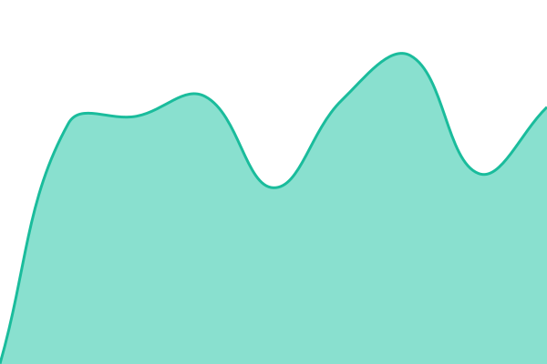
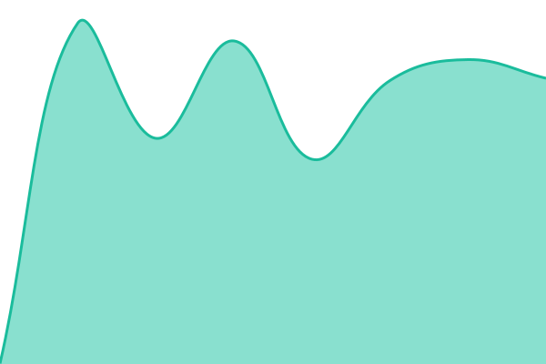
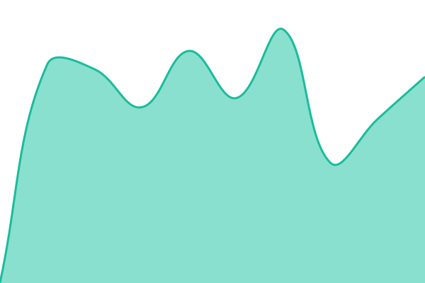

# [📈 Live Status](https://upptime.byungchan.kim): <!--live status--> **🟩 All systems operational**

This repository contains the open-source uptime monitor and status page for [ByungchanKim](https://www.linkedin.com/in/byungchan-kim-348b0214a/), powered by [Upptime](https://github.com/upptime/upptime).

With [Upptime](https://upptime.js.org), you can get your own unlimited and free uptime monitor and status page, powered entirely by a GitHub repository. We use [Issues](https://github.com/kbc8894/upptime/issues) as incident reports, [Actions](https://github.com/kbc8894/upptime/actions) as uptime monitors, and [Pages](https://upptime.byungchan.kim) for the status page.

<!--start: status pages-->
<!-- This summary is generated by Upptime (https://github.com/upptime/upptime) -->
<!-- Do not edit this manually, your changes will be overwritten -->
<!-- prettier-ignore -->
| URL | Status | History | Response Time | Uptime |
| --- | ------ | ------- | ------------- | ------ |
|  [Blog](https://blog.byungchan.kim) | 🟩 Up | [blog.yml](https://github.com/kbc8894/upptime/commits/HEAD/history/blog.yml) | 

 930ms
     
 | 

<a href="https://upptime.byungchan.kim/history/blog">100.00%</a>
    

|  [Bitwarden](https://vault.byungchan.kim) | 🟩 Up | [bitwarden.yml](https://github.com/kbc8894/upptime/commits/HEAD/history/bitwarden.yml) | 

 884ms
     
 | 

<a href="https://upptime.byungchan.kim/history/bitwarden">100.00%</a>
    

|  [Jellyfin](https://jellyfin.byungchan.kim) | 🟩 Up | [jellyfin.yml](https://github.com/kbc8894/upptime/commits/HEAD/history/jellyfin.yml) | 

 1632ms
     
 | 

<a href="https://upptime.byungchan.kim/history/jellyfin">93.86%</a>
    

|  [Dashboard](https://dashboard.byungchan.kim) | 🟩 Up | [dashboard.yml](https://github.com/kbc8894/upptime/commits/HEAD/history/dashboard.yml) | 

 1057ms
     
 | 

<a href="https://upptime.byungchan.kim/history/dashboard">100.00%</a>
    

|  [UpSnap](https://upsnap.byungchan.kim) | 🟩 Up | [up-snap.yml](https://github.com/kbc8894/upptime/commits/HEAD/history/up-snap.yml) | 

 669ms
     
 | 

<a href="https://upptime.byungchan.kim/history/up-snap">100.00%</a>
    

|  [RSS (Miniflux)](https://rss.byungchan.kim) | 🟩 Up | [rss-miniflux.yml](https://github.com/kbc8894/upptime/commits/HEAD/history/rss-miniflux.yml) | 

 853ms
     
 | 

<a href="https://upptime.byungchan.kim/history/rss-miniflux">92.81%</a>
    

|  [Portainer](https://portainer.byungchan.kim) | 🟩 Up | [portainer.yml](https://github.com/kbc8894/upptime/commits/HEAD/history/portainer.yml) | 

 609ms
     
 | 

<a href="https://upptime.byungchan.kim/history/portainer">99.80%</a>
    

<!--end: status pages-->

[**Visit our status website →**](https://upptime.byungchan.kim)

## 📄 License

- Powered by: [Upptime](https://github.com/upptime/upptime)
- Code: [MIT](./LICENSE) © [ByungchanKim](https://www.linkedin.com/in/byungchan-kim-348b0214a/)
- Data in the `./history` directory: [Open Database License](https://opendatacommons.org/licenses/odbl/1-0/)
